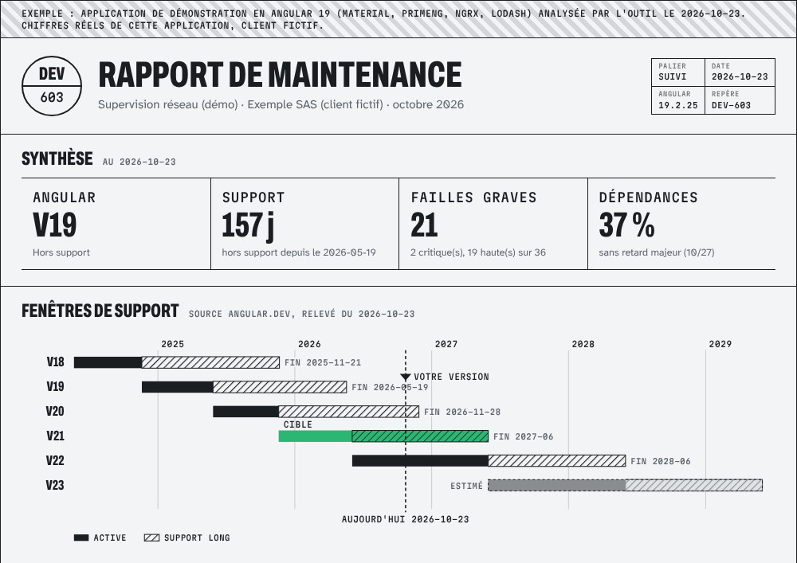

# ngm — maintenance mensuelle d'une application Angular

`ngm` dit en une commande où en est une application Angular : sa version est-elle encore soutenue, quelles failles connues traînent dans ses dépendances, ce qui est en retard, et dans quel ordre tout remettre à niveau. Il sait aussi appliquer les mises à jour sans risque et monter d'une version majeure, sur une branche dédiée, **en vérifiant chaque fois avec le lint, les tests et le build du projet**.



Rapport d'exemple complet, produit sur une application de démonstration en Angular 19 : [docs/exemple-rapport.html](docs/exemple-rapport.html).

* Aucune dépendance : Node.js 20.19 ou plus récent, npm et git.
* Lecture seule par défaut. `sures` et `majeure` travaillent sur une nouvelle branche ; rien n'est poussé sans `--pousser`.
* Pas de télémétrie, pas d'IA, pas d'appel réseau autre que le registre npm (via votre propre `npm`, donc votre proxy et votre `.npmrc`).

## Démarrer (5 minutes)

```bash
cd mon-application-angular
npx --yes github:consigne/ngm diagnostic
```

Exemple de sortie (application Angular 19 de démonstration, 23 octobre 2026) :

```
appli-test · Angular 19.2.25 · HORS SUPPORT (fin 2026-05-19)
Failles : 36 (2 critiques, 19 hautes) · dépendances sans retard majeur : 37 % · cible conseillée : Angular 21

  P1  Angular 19 n'est plus soutenu depuis le 2026-05-19
      Plus aucun correctif de sécurité. Cible conseillée : Angular 21.
  P1  2 faille(s) critique(s) connue(s)
      dépendances indirectes : piscina, tar
  P2  19 faille(s) de gravité haute
      6 paquet(s) Angular, corrigés par la montée de version ; lodash (correctif sans majeure) ; primeng → 22.1.4 (majeure)
  P3  15 faille(s) moyenne(s) ou faible(s)
  P3  4 bibliothèque(s) en retard d'une version majeure (hors Angular)
      @ngrx/store 19.2.1 → 22.0.1, @types/jasmine 5.1.15 → 7.0.0, jasmine-core 5.6.0 → 7.0.2, primeng 19.1.4 → 22.1.4
  P4  1 mise(s) à jour sans risque disponible(s) dans les plages déclarées
      lodash 4.17.15 → 4.18.1
```

Pour l'installer une fois pour toutes : `npm install -g github:consigne/ngm`, puis `ngm --aide`.

## Commandes

| Commande | Ce qu'elle fait | Modifie le dépôt ? |
|---|---|---|
| `ngm diagnostic [dossier]` | Support d'Angular, failles, dépendances, actions P1 à P4. `--json etat.json`, `--markdown resume.md`, `--echec-si P1` pour la CI | Non |
| `ngm plan [dossier] [--vers 22]` | Montée de version, une majeure à la fois : commandes `ng update`, Node et TypeScript requis, bibliothèques tierces à faire suivre, estimation en heures | Non |
| `ngm sures [dossier]` | Correctifs et mineures dans les plages de `package.json`, puis `npm audit fix` sans `--force`, sur la branche `maintenance/AAAA-MM`. En cas d'échec, chaque paquet est retenté seul | Nouvelle branche |
| `ngm majeure [dossier] --vers 21` | Une étape du plan sur la branche `maintenance/angular-21`, puis lint, tests, build | Nouvelle branche |
| `ngm mois --fiche client.json` | Routine du mois : diagnostic, `sures`, plan, rapport HTML + Markdown + PDF | Nouvelle branche |
| `ngm rapport --fiche client.json` | Rapport seul | Non |
| `ngm heures ajouter / bilan` | Relevé du temps passé par client (`interventions.csv`) | Non |
| `ngm portefeuille dossier-clients/` | Tableau de bord de tous les clients | Non |

Les vérifications utilisent les scripts du projet : `lint`, `test:ci` (sinon `test`, lancé une fois sans surveillance), `build`. Pour les remplacer, mettez-les dans la fiche client (`"commandes": { "test": "npx vitest run" }`).

### Fiche client (`client.json`)

```json
{
  "client": "Exemple SAS",
  "application": "Supervision réseau",
  "palier": "suivi",
  "depot": "../depots/supervision",
  "interventions": "interventions.csv",
  "suivi": "suivi",
  "commandes": { "test": "npm run test:ci" }
}
```

Les rapports sont écrits dans `suivi/AAAA-MM/` à côté de la fiche. Le PDF est produit si Chrome ou Chromium est installé (variable `CHROME_BIN` si besoin).

### Dans la CI

* GitHub Actions : copiez [ci/github/maintenance-angular.yml](ci/github/maintenance-angular.yml) dans `.github/workflows/`. Chaque 1er du mois, il ouvre une issue avec l'état du projet. Lecture seule.
* GitLab : [ci/gitlab/maintenance-angular.gitlab-ci.yml](ci/gitlab/maintenance-angular.gitlab-ci.yml), avec une planification de pipeline.
* Renovate : le préréglage [ci/renovate.json](ci/renovate.json) regroupe les mineures une fois par mois et laisse les majeures d'Angular à `ng update`.

## Questions fréquentes

**D'où viennent les dates de support ?** De [angular.dev/reference/releases](https://angular.dev/reference/releases), relevées dans `src/support.mjs` (date du relevé dans chaque rapport). Une nouvelle version de `ngm` sort à chaque majeure d'Angular.

**Pourquoi une seule majeure à la fois ?** C'est la règle d'Angular : les migrations automatiques de `ng update` ne s'enchaînent que d'une majeure à la suivante.

**Mes bibliothèques tierces bloquent `ng update`.** C'est le cas le plus courant (PrimeNG exige le CDK de la même majeure, NgRx la même version d'Angular). `ngm plan` cherche pour chacune la dernière version compatible et les passe toutes dans le même `ng update`, pour que les dépendances de pair se résolvent ensemble.

**`ngm` remplace-t-il Renovate ou Dependabot ?** Il les complète : il vérifie chaque mise à jour avec vos tests avant de la proposer, fait les montées majeures avec les migrations d'Angular et écrit un rapport lisible par quelqu'un qui ne lit pas les journaux de CI.

## Problèmes courants

| Symptôme | Cause | Solution |
|---|---|---|
| `le dépôt a des modifications non commitées` | `sures` et `majeure` partent d'un arbre propre | `git stash` ou commit, puis relancer |
| `la branche maintenance/AAAA-MM existe déjà` | Routine déjà lancée ce mois-ci | Supprimer la branche ou passer `--branche` |
| Tests Karma qui ne démarrent pas | Pas de Chrome sur la machine ou la CI | `CHROME_BIN=/chemin/vers/chromium`, ou un script `test:ci` avec ChromeHeadless |
| `npm error Cannot read properties of null (reading 'edgesOut')` pendant une montée vers Angular 21 | Bogue de npm 10 sur les dépendances de pair facultatives d'`@angular/build` | `npm install -g npm@11` (le plan le signale avant de commencer) |
| `Lecture impossible de … sur le registre` | Paquet privé ou registre injoignable | Vérifier `.npmrc` et le proxy ; le plan reste valable pour les autres paquets |

## Développer

```bash
npm test        # 21 tests, sans réseau (sorties npm enregistrées sur une vraie application Angular 19)
```

## Faire faire la maintenance

`ngm` est l'outil de l'offre de maintenance Angular par abonnement de Consigne (prix publics, 100 % à distance) : [maintenance-angular.pages.dev](https://maintenance-angular.pages.dev/). Contact : support@consignestudio.fr.

## Licence

MIT, voir [LICENSE](LICENSE). Polices du rapport sous licence SIL OFL 1.1 (fichiers dans `assets/fonts/`). Angular est une marque de Google LLC ; ce projet en est indépendant.
